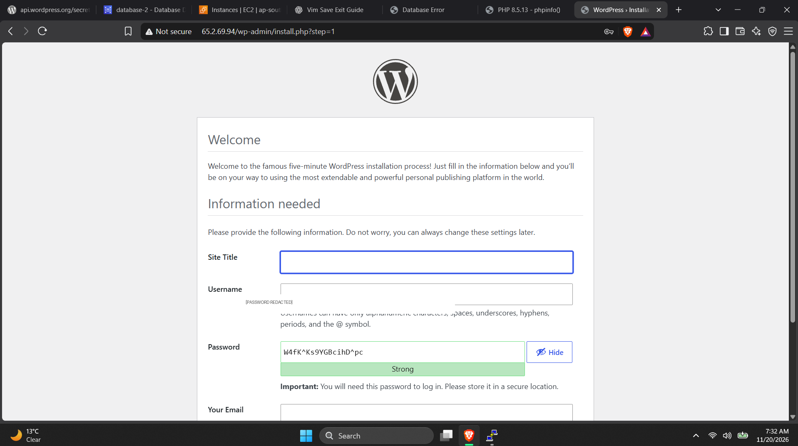

# TechBridge — WordPress Hosting on AWS (LAMP Stack)


A hands-on AWS lab that deploys a WordPress website on an **Amazon EC2** Linux instance, using **Amazon RDS for MySQL** as the database.

> **Lab evidence:** The supplied screenshots show the EC2 instance running with 3/3 status checks passed, the RDS database in Available status, the WordPress installer page, and the final `techbridge` website.

---

## Table of contents

- [Project overview](#project-overview)
- [Architecture](#architecture)
- [AWS resources](#aws-resources)
- [Prerequisites](#prerequisites)
- [Deployment guide](#deployment-guide)
- [WordPress database configuration](#wordpress-database-configuration)
- [Verification](#verification)
- [Troubleshooting](#troubleshooting)
- [Security notes](#security-notes)
- [Cleanup](#cleanup)
- [Screenshots](#screenshots)

## Project overview

This project demonstrates how to host a WordPress website using a traditional LAMP-style architecture on AWS.

| Layer | Technology | Responsibility |
|---|---|---|
| L | Amazon Linux on EC2 | Operating system / compute |
| A | Apache (`httpd`) | Web server |
| M | MySQL on Amazon RDS | Persistent database |
| P | PHP | Runs WordPress |

**Application:** WordPress  
**Website name shown in output:** `techbridge`  
**AWS Region shown in the lab:** Asia Pacific (Mumbai), `ap-south-1`

## Architecture

```text
                         Internet
                            |
                      HTTP : TCP/80
                            |
                 +----------------------+
                 |     Amazon EC2       |
                 |      LampStack1      |
                 |                      |
                 |    Amazon Linux      |
                 |    Apache / httpd    |
                 |        PHP           |
                 |     WordPress        |
                 +----------------------+
                            |
                     MySQL : TCP/3306
                            |
                 +----------------------+
                 |      Amazon RDS      |
                 |      database-2      |
                 |        MySQL         |
                 |   Private database   |
                 +----------------------+
```

The EC2 instance serves the WordPress website. WordPress connects to the MySQL database hosted separately on Amazon RDS.

## AWS resources

| Resource | Lab configuration / observed value |
|---|---|
| Region | `ap-south-1` (Mumbai) |
| EC2 instance name | `LampStack1` |
| EC2 instance type | `t3.micro` |
| EC2 state | Running |
| EC2 status checks | 3/3 checks passed |
| Availability Zone | `ap-south-1b` |
| RDS DB identifier | `database-2` |
| RDS status | Available |
| Database name used in lab notes | `wordpress` |
| WordPress database user in lab notes | `wpuser` |

The exact RDS endpoint, database password, and administrator credentials are intentionally not included in this repository.

## Prerequisites

- AWS account
- EC2 key pair for SSH access
- Basic Linux command-line knowledge
- VPC and appropriate subnets for EC2 and RDS
- EC2 security group allowing HTTP and restricted SSH
- RDS MySQL database in the same VPC as EC2
- RDS security group allowing MySQL from the EC2 security group

## Deployment guide

### 1. Launch the EC2 instance

Launch an Amazon Linux EC2 instance and attach a security group.

Recommended inbound rules:

| Type | Port | Source |
|---|---:|---|
| SSH | 22 | Your public IP only |
| HTTP | 80 | `0.0.0.0/0` for a public website |
| HTTPS | 443 | `0.0.0.0/0` when HTTPS is configured |

Connect to the instance:

```bash
ssh -i your-key.pem ec2-user@<EC2-PUBLIC-IP>
```

### 2. Create the RDS MySQL database

Create an RDS MySQL database in the same VPC as the EC2 instance.

- Keep **Public access** disabled.
- Configure the RDS security group to allow TCP port `3306` from the EC2 security group.
- Note the RDS endpoint from **RDS → Databases → your DB → Connectivity & security**.

### 3. Install the MySQL client and connect to RDS

The lab command history records installation of the MariaDB/MySQL client and setting an environment variable for the RDS endpoint.

```bash
sudo dnf update -y
sudo dnf install -y mariadb105
mysql --version

export MYSQL_HOST=<your-RDS-endpoint>
mysql -h "$MYSQL_HOST" -P 3306 -u <DB-USER> -p
```

Enter the database password when prompted. Do not put passwords directly in shell history or this README.

### 4. Create the WordPress database and user

Run these SQL statements after connecting to MySQL with an administrative account. Replace the placeholder with a strong password.

```sql
CREATE DATABASE wordpress;

CREATE USER 'wpuser'@'%'
IDENTIFIED BY '<STRONG_PASSWORD>';

GRANT ALL PRIVILEGES ON wordpress.* TO 'wpuser'@'%';

FLUSH PRIVILEGES;
EXIT;
```

### 5. Install and start Apache

For Amazon Linux 2023, use `dnf` and `systemctl`:

```bash
sudo dnf install -y httpd
sudo systemctl enable --now httpd
sudo systemctl status httpd
```

### 6. Download WordPress

```bash
cd ~
wget https://wordpress.org/latest.tar.gz
tar -xzf latest.tar.gz
cd wordpress
```

### 7. Configure `wp-config.php`

Create the configuration file from the sample:

```bash
cp wp-config-sample.php wp-config.php
vi wp-config.php
```

Set the database values:

```php
define( 'DB_NAME', 'wordpress' );
define( 'DB_USER', 'wpuser' );
define( 'DB_PASSWORD', '<STRONG_PASSWORD>' );
define( 'DB_HOST', '<your-RDS-endpoint>' );
```

Generate fresh WordPress authentication keys and salts from the official generator:

<https://api.wordpress.org/secret-key/1.1/salt/>

Replace the sample keys in `wp-config.php` with the generated values.

### 8. Install PHP and deploy WordPress files

The lab notes originally include an Amazon Linux 2 `amazon-linux-extras` command. The command history also shows the Amazon Linux 2023 `dnf` approach. For Amazon Linux 2023, install the web/PHP packages with:

```bash
sudo dnf install -y httpd wget php-fpm php-mysqli php-json php
```

Copy WordPress into Apache's document root:

```bash
cd /home/ec2-user
sudo cp -r wordpress/* /var/www/html/
sudo chown -R apache:apache /var/www/html
sudo systemctl restart httpd
```

Because the database is hosted on RDS, a local MariaDB database server is not required on the EC2 web server.

### 9. Open the WordPress installer

Open the EC2 public IPv4 address:

```text
http://<EC2-PUBLIC-IP>
```

Complete the WordPress setup form with a site title, administrator username, strong administrator password, and email address.

The supplied lab screenshot shows the WordPress installer page loading successfully.

## WordPress database configuration

WordPress uses `wp-config.php` to connect to RDS.

| Setting | Value used in lab notes |
|---|---|
| `DB_NAME` | `wordpress` |
| `DB_USER` | `wpuser` |
| `DB_PASSWORD` | Your database password (keep secret) |
| `DB_HOST` | Your RDS endpoint |

**Never commit `wp-config.php`, database credentials, private keys, or generated passwords to GitHub.**

## Verification

Useful checks:

```bash
sudo systemctl status httpd
sudo systemctl status php-fpm
sudo tail -n 50 /var/log/httpd/error_log
mysql -h "$MYSQL_HOST" -P 3306 -u wpuser -p -e "SHOW DATABASES;"
```

Open the EC2 public IP in a browser and verify that the WordPress site loads.

### Observed lab results

- EC2 console: `LampStack1` was **Running**.
- EC2 health: **3/3 status checks passed**.
- RDS console: `database-2` was **Available**.
- Browser: WordPress installer page was displayed.
- Final browser output: the `techbridge` website and Blog page were displayed.

The terminal image supplied with the lab is a shell `history` listing. It shows commands entered, but not the individual output of every command. Therefore, this repository does not claim unseen SQL success messages or other unprovided command outputs.

## Troubleshooting

| Problem | What to check |
|---|---|
| Error establishing a database connection | Verify `DB_NAME`, `DB_USER`, `DB_PASSWORD`, `DB_HOST`; check RDS status and port 3306 access |
| MySQL connection timeout | Check RDS endpoint, VPC, subnet routing, and RDS security-group inbound rule |
| Access denied for user | Confirm the database username/password and grants |
| Website does not open | Check EC2 state, inbound HTTP port 80, and Apache service |
| 403 Forbidden | Check ownership of `/var/www/html` |
| Blank page / PHP issue | Verify PHP packages and Apache/PHP-FPM configuration; inspect Apache logs |

Useful Apache commands:

```bash
sudo systemctl status httpd
sudo systemctl restart httpd
sudo tail -f /var/log/httpd/error_log
```

## Security notes

- Keep the RDS database private.
- Allow MySQL TCP/3306 only from the EC2 security group.
- Restrict SSH TCP/22 to your own public IP.
- Review and remove broad inbound rules such as unrestricted “All traffic” access unless specifically required.
- Use strong, unique passwords.
- Do not upload `.pem` files, `wp-config.php`, passwords, or salts to GitHub.
- Configure HTTPS before using the website for real users.

## Cleanup

To avoid ongoing AWS charges after the lab:

1. Take an RDS snapshot if you need to retain the database.
2. Terminate the EC2 instance when it is no longer required.
3. Delete the RDS database if it is no longer needed.
4. Remove unused snapshots and security groups only after checking dependencies and backup requirements.

## Screenshots

The repository bundle includes the evidence images in the `screenshots/` directory.

### EC2 instance


### EC2 security group


### RDS database


### Terminal command history


### WordPress installer



### Final TechBridge website


---

## Project status

**Lab completed with visible evidence of EC2 availability, RDS availability, WordPress installer access, and the final TechBridge website page.**

Created as an AWS learning lab to practice EC2, RDS, Linux administration, Apache, PHP, MySQL connectivity, and WordPress deployment.
